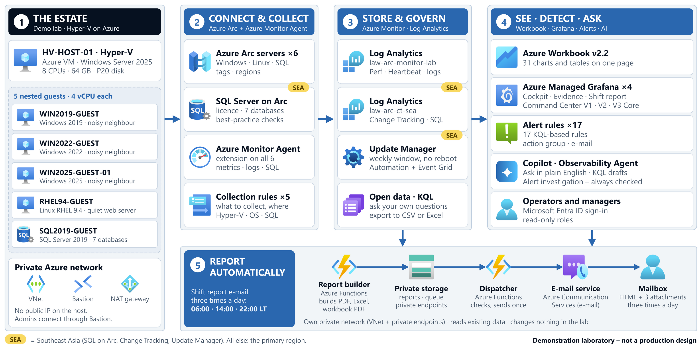

# Advanced End-to-End Observability for Hyper-V Estates

[](https://github.com/stefpin/hyperv-estate-observability-azure-arc-monitor/actions/workflows/ci.yml)

**From the host scheduler to SQL Server memory grants - with Azure Arc, Azure Monitor and Managed Grafana.**

A reproducible reference implementation: a nested Hyper-V lab, the Azure Arc and Azure Monitor plumbing that
observes it, custom collectors for the signals Azure does not ship, 47 KQL and Resource Graph queries, 17 alert rules, a
one-page workbook with 31 charts and tables, eleven Managed Grafana dashboards, a gated patching guard, Change Tracking,
and an automated shift-report e-mail (PDF + Excel + full-value PDF) built on Azure Functions. Every step is written down:
roughly 100,000 words of operator and presenter documentation sit next to the code.

> **Status:** reference lab and teaching material, not a production product. Read [Limitations](#limitations-stated-honestly)
> before you reuse an idea in a real estate.



*The diagram source is [diagrams/architecture-overview.drawio](diagrams/architecture-overview.drawio) (editable in
draw.io / diagrams.net).*

## Why this exists

A VM that shows "100% CPU" tells you nothing about who is waiting for whom. In a virtualised estate the questions that
matter live in different layers, and each layer has its own counters:

| Question | Layer that knows | What this repo collects and shows |
|---|---|---|
| Is the **host** saturated? | Hypervisor | `Hyper-V Hypervisor Logical Processor\% Total Run Time` on the host |
| Are guests **waiting** for a processor? | Hypervisor scheduler | `CPU Wait Time Per Dispatch` per guest (nanoseconds per dispatch - deliberately **not** called "CPU ready %") |
| What share of a processor did each vCPU **actually get**, against what the guest asked for? | Hypervisor vs guest | Per-vCPU `% Total Run Time` next to the guest's own CPU % and run queue |
| Is SQL Server **short of memory**, or just full? | SQL Server + OS | A 15-second custom collector: ceiling, committed, cache, workspace-grant used/granted/pending, OS available memory |
| Where is **storage latency** introduced? | Guest, VHDX, host disk, Azure disk | Layered latency and IOPS panels that are explicitly **not additive** |
| What **changed** on the SQL server? | Guest OS | Change Tracking and Inventory with a dedicated rule and workspace |
| Can we **patch safely**? | Update Manager + Automation | Pre/post guard runbook, tag-gated dynamic scope, cancellation cut-off |
| Who gets told, and with what **evidence**? | Alerts + reporting | Alert rules with a single action group, and a three-attachment shift report that arrives by itself |

The lab makes the gap visible on purpose: with 20 vCPUs assigned to a host that has eight logical processors, three guests
that report 100% busy can still be receiving only about two thirds of a processor each. Only the host-side counters show
the missing third.

## What is in the box

| Folder | Contents |
|---|---|
| [`docs/setup`](docs/setup/) | The operator guide: 27 chapters from the Azure foundation to cost control, with exact portal clicks, commands, expected results and troubleshooting |
| [`docs/demo`](docs/demo/) | The presenter storyline: how to read every dashboard and chart, Acts 0-12 plus Act 8B (Azure Copilot and the Observability Agent), capability checklist, Q&A and appendices |
| [`lab-kit`](lab-kit/) | More than 70 PowerShell scripts, four data collection rule definitions plus the Change Tracking rule, 17 alert rule payloads, 47 KQL and Resource Graph queries, custom table schemas, collectors for SQL Server and RHEL, workbook sources, the maintenance guard runbook and its offline tests |
| [`monitoring/grafana`](monitoring/grafana/) | 11 Azure Managed Grafana dashboards in four families (operations cockpit and evidence report; Command Center V1, V2 and V3 Core) |
| [`shift-report`](shift-report/) | A Python 3.12 Azure Functions application (producer + dispatcher), its ARM templates and a 173-test offline suite |
| [`diagrams`](diagrams/) | Editable architecture diagram (draw.io) and a PNG export |
| [`tools`](tools/) | `Set-RepoContext.ps1` replaces the placeholders with your own subscription, tenant, region, workspace IDs and recipient; `validate_repo.py` checks JSON, Python and Markdown links (it runs in CI) |

## Highlights

* **Three-metric CPU contention model.** Host saturation, per-guest dispatch wait and run-share-against-demand are shown
  side by side, with the guest's own view next to the hypervisor's view. The wait counter is reported in the unit the
  hypervisor uses; thresholds are expressed relative to a quiet baseline instead of borrowing a foreign rule of thumb.
* **SQL Server memory that reconciles.** The custom collector exposes the numbers needed to check SQL Server's own
  accounting (committed = free + cache + other internal; granted - used = reserved server memory), so a "memory is full"
  claim can be tested instead of assumed. The ceiling, committed memory, cache and workspace grants are never summed.
* **Careful about what each number means.** Missing or stale telemetry is shown as *insufficient evidence*, never as healthy. Hypervisor
  wait is not CPU-ready percent, Windows "cluster" tags are a monitoring group and not failover clustering, storage layers
  are not additive, and a collection-rule association is not proof that data arrived.
* **Safe management.** Update Manager targets a single SQL machine through two AND-ed tags. A guard runbook checks SQL
  before and after, keeps its original baseline across duplicate events and can cancel a run before a cut-off. Arming is a
  deliberate, reversible tag change.
* **Reports that arrive by themselves.** Three times a day (06:00, 14:00 and 22:00 local time, UTC+7) a producer Function
  freezes the evidence and renders Grafana PDF pages and an Excel workbook; a second Function with a different identity
  sends one e-mail with three attachments (charts PDF, workbook, and a PDF of every workbook cell). Immutable storage,
  exact-bytes policy pinning, durable de-duplication and fail-closed gates are designed so that a message is not sent twice
  or from an unreviewed build. See [shift-report/README.md](shift-report/README.md).
* **A guide that can be followed.** Every chapter states where to run each step (portal, operator PC, host, guest),
  gives the exact commands, says what you should see, and lists what to do when you do not.

## Quick start

1. **Read** [`docs/setup/01`](docs/setup/01-scope-architecture-and-success-criteria.md) (scope and architecture),
   [`02`](docs/setup/02-tools-secrets-and-conventions.md) (tools, secrets, conventions) and
   [`03`](docs/setup/03-build-order-and-change-gates.md) (build order and change gates).
2. **Replace the placeholders** (dry run first):

   ```powershell
   .\tools\Set-RepoContext.ps1 -SubscriptionId <guid> -TenantId <guid> -PrimaryRegion <region>
   .\tools\Set-RepoContext.ps1 -SubscriptionId <guid> -TenantId <guid> -PrimaryRegion <region> -Apply
   ```

3. **Create the private settings file** with `lab-kit\Initialize-LabSecrets.ps1`. It prompts for every secret, writes
   `ENVIRONMENT.txt` (git-ignored, restricted ACL) and never overwrites an existing file. `ENVIRONMENT.example.txt` lists
   the keys.
4. **Build in order**, continuing at the first incomplete chapter: Azure foundation, host VM, Hyper-V and guest network,
   guests, RHEL collectors, the lab-only metadata protection, Arc onboarding, Azure Monitor Agent and collection rules, SQL Server, SQL on Arc, SQL memory
   collector and custom table, storage telemetry, CPU contention scene, workbook, alerts, Update Manager, Change Tracking,
   rehearsal scenes.
5. **Import the dashboards** from `monitoring/grafana` ([instructions](monitoring/README.md)) and, when you want the
   automated shift report, deploy `shift-report/infra` and the Function app ([instructions](shift-report/README.md)).
6. **Present or study** with [`docs/demo`](docs/demo/).

The lab runs a Standard_E8s_v5 virtual machine, a Bastion host, a NAT gateway and several Log Analytics workspaces. It
costs money while it exists: see [chapter 25](docs/setup/25-cost-and-operations.md), tag the resource group, and remove
it when you are done.

## Documentation map

| Start here | Then |
|---|---|
| [Documentation index](docs/README.md) | [Architecture notes](docs/architecture.md) |
| [Operator guide](docs/setup/) | [Presenter storyline](docs/demo/) |
| [Lab kit reference](docs/setup/26-lab-kit-reference.md) | [Troubleshooting](docs/setup/24-troubleshooting.md) |

## Limitations, stated honestly

* The "on-premises" estate is an **Azure virtual machine running nested Hyper-V**. It behaves like an on-premises host for
  Arc and monitoring purposes (chapter 9 explains the lab-only protection that makes that possible), but it is not
  physical hardware, and Azure-layer contention underneath the host is invisible to the guest-side counters.
* Counters describe the platform, not the user's experience. No application-level response-time collector is included
  for the guests.
* Minute averages hide short bursts: use the sample P95 and maximum views before you conclude that nothing waited.
* Some Azure management features are not available in every region, so the lab places some resources in a second region
  (Southeast Asia in this kit): SQL on Arc, Change Tracking and Update Manager. The data therefore does not all live
  in one region.
* Time zones: reports and dashboards display UTC+7 as the worked example (labelled "LT") with UTC alongside. Change the
  zone in the dashboards, the report schedule and the documentation if your estate is elsewhere.
* The repository was converted from a working lab by an automated, reviewed process. The scripts parse, the offline tests
  pass and every link resolves, but a complete rebuild from this repository in a fresh subscription has not been
  performed: expect to adjust small details (names, regions, SKUs, quotas) as you go, and report what you find.
* Nothing here has been security-hardened for production. Treat the scripts as readable lab code: inspect before you run,
  never run an unfamiliar script against a subscription you care about, and keep secrets out of Git.

## Adapting the repository

All identifiers are neutral placeholders (`<SUBSCRIPTION_ID>`, `<TENANT_ID>`, `<PRIMARY_REGION>`, `<SUFFIX>` for globally
unique resource names, sentinel GUIDs `00000000-0000-0000-0000-0000000000NN`, `operator@example.com`).
`tools/Set-RepoContext.ps1` replaces the first group. The shift-report application additionally needs its environment
constants edited and its policy
re-pinned, as described in [shift-report/README.md](shift-report/README.md). `ENVIRONMENT.txt` is private and git-ignored.

## License and notices

Released under the [MIT License](LICENSE). Third-party components, trademarks and one dependency with a copyleft
licence (PyMuPDF, AGPL-3.0 or commercial) are discussed in [NOTICE.md](NOTICE.md). The materials were derived from a
private demonstration lab; see [SANITIZATION.md](SANITIZATION.md) for how identifiers and environment-specific content
were removed.

*This repository is an independent project. It is not an official Microsoft product and is not endorsed by Microsoft or
any other company named in it. Microsoft, Azure, Hyper-V, SQL Server and Windows Server are trademarks of the Microsoft
group of companies; Grafana is a trademark of Grafana Labs.*
