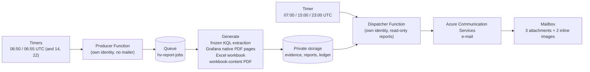

# Shift report: three attachments, sent at most once

An Azure Functions application (Python 3.12) that turns the lab's existing telemetry into a shift-end report and
e-mails it three times a day. It is designed so that a report can be reviewed, reproduced and audited, and so that a
message is not sent twice and not sent from a build nobody reviewed.



Dispatch times are 06:00, 14:00 and 22:00 local time (UTC+7, no daylight saving), which is 23:00, 07:00 and 15:00 UTC.
The source cutoff is five minutes before each boundary and the source window is the eight hours before it.

## The e-mail

| Part | Name | Content |
|---|---|---|
| Attachment 1 | `HV-<reportId>.pdf` | A summary page and exactly eight native Grafana chart pages (CPU, memory, SQL memory, SQL grants, cluster storage, contention, storage, SQL activity) |
| Attachment 2 | `HV-<reportId>.xlsx` | Every evidence dataset in full, the query provenance and the plotted chart data (20 sheets) |
| Attachment 3 | `HV-<reportId>-workbook.pdf` | Every cell of the Excel file rendered as PDF pages, formula results shown as cached values; typically hundreds of pages |
| Inline images | `brand-primary.png`, `brand-secondary.png` | Small neutral placeholder marks referenced by the HTML body (they are not attachments) |

The subject looks like `Hyper-V Estate - Shift Report - 25 Jul 2026 - Cutoff 21:55 LT` and gets a `[TEST]` suffix for
rehearsals. The combined size of the documents and images is limited to 5 MiB. Missing or stale telemetry produces the
status *INSUFFICIENT EVIDENCE*, never a healthy one.

## Safety properties

* **Two apps, two identities.** The producer has no mailer and no send endpoint. The dispatcher can read reports but not
  write them, and cannot write approvals.
* **Immutable evidence.** Evidence, reports and the e-mail envelope are written create-only; the dispatcher verifies sizes
  and SHA-256 values of every document and image before it claims a report.
* **Fail-closed gates.** `SEND_ENABLED`, `SCHEDULE_ENABLED` and `AUTO_SEND_ENABLED` default to `false`. Scheduled sending
  additionally requires `AUTO_SEND_POLICY_SHA256` to equal the SHA-256 of the exact bytes of
  `app/config/scheduled-send-policy.json`, which in turn pins the hash of every runtime, configuration and rendering
  input. Change any pinned file and the policy refuses to send until a person re-pins it.
* **At most once.** A conditional-create durable claim is written before submission. An interrupted submission becomes
  *DeliveryUncertain*, never an automatic resend. Azure Communication Services "Succeeded" means *accepted*, not
  *delivered*.
* **Manual path with exact approval.** `POST /api/dispatch` always needs a per-report approval blob that names the report ID
  and the SHA-256 of the exact envelope returned by `GET /api/preview`.
* **No backfill.** Missed timers are skipped; nothing is sent at start-up or from a past-due timer.

The complete contract (routes, ledger states, approval schema, budgets, activation checklist) is in
[app/CONTRACT.txt](app/CONTRACT.txt).

## Layout

```text
shift-report/
  app/                  the Function app (function_app.py, domain.py, runtime.py, adapters.py, artifacts.py,
                        workbook_pdf.py, email_template.py, automation.py, queries.py, health_rules.py)
    config/             query manifest, alert rules, dashboard builder, banner, e-mail branding, pinned policy
    tests/              173 offline unit tests (fake services; no network)
    CONTRACT.txt        operator-facing contract
  infra/                reference ARM templates: private network, runtime, communication services, operator container
  tools/pin_policy.py   regenerates the scheduled-send policy and prints the pin
```

## Make it yours

1. **Edit the environment constants** at the top of `app/domain.py` (`SUB`, `RG`, `WORKSPACES` with your Log Analytics
   workspace resource IDs and workspace IDs, `MACHINES`, `GRAFANA_ENDPOINT`, `QUEUE`, the dashboard, folder and datasource
   UIDs, `PILOT_RECIPIENT`) and the sender, policy ID and first boundary in `app/automation.py` (`SENDER`, `POLICY_ID`,
   `FIRST_BOUNDARY`, and the illustrative `APPROVAL` and `REVISION` blocks - record your own review evidence there).
   `tools/Set-RepoContext.ps1` can substitute the subscription, region, resource group, recipient, sender, name suffix,
   the two workspace IDs and the Grafana host name for you.
2. **Replace the brand images** in `app/config/email-branding/` and `app/config/banner.png` with your own approved
   artwork (update `manifest.json` size and SHA-256 values to match), or keep the neutral placeholders.
3. **Run the tests** from `app/`:

   ```powershell
   python -m pip install -r requirements.txt
   python -m unittest discover -s tests -q
   ```

4. **Re-pin the policy** whenever any pinned input changed (that includes everything you edited above). Run it from the
   `shift-report` folder:

   ```powershell
   python tools/pin_policy.py
   ```

   The command rewrites `app/config/scheduled-send-policy.json` and prints the value for `AUTO_SEND_POLICY_SHA256`. Keep
   line endings unchanged: this repository forces LF through `.gitattributes`, and the pin covers exact bytes.

## Deploy

The ARM templates in `infra/` are reference snapshots of the environment this code was built for. They contain no
parameters: replace the placeholders (`<SUFFIX>` for globally unique names, `<PRIMARY_REGION>`, `<SUBSCRIPTION_ID>` and the
Grafana host `<GRAFANA_ENDPOINT>`, which must equal the one in `app/domain.py`) before use, review every property, and deploy them to a resource group you own.

1. Deploy `private-network.json`, `runtime.json` and `communication.json` (and `operator-container.json` if you want the
   private operator container for approvals). Storage accounts disable shared-key access; the Function apps use
   identity-based host storage.
2. Give each identity only the roles it needs: the producer (blob and queue data access to its containers, read access to
   the two Log Analytics workspaces and the resource group, Grafana Editor for the dedicated report dashboard); the
   dispatcher (read access to reports and the right to send through your Communication Services resource). Approvals
   are written by a separate operator identity that is not either app. The contract file lists what each endpoint
   touches.
3. Build the package with Linux wheels for Python 3.12 (install `requirements.txt` into `.python_packages/lib/site-packages`
   for the `manylinux` platform), keep the pinned files byte-identical, and make sure every file in the ZIP is readable
   (mode 0644): a ZIP that carried mode 0600 for the root files was accepted by Azure but the host failed to start with
   "access denied" on `host.json`.
4. Deploy the same package to both apps, then check `GET /api/automation` on each: it reports `Gated`, `Enabled`,
   `InvalidPolicy` or `Disabled`, the pinned fingerprints and the next eligible times, without reading any secret.
5. Run a **rehearsal** before any gate is opened:

   ```text
   POST /api/prepare   {"mode":"dryrun"}                 (producer)  -> reportId
   GET  /api/status?reportId=<id>                        until Ready
   GET  /api/preview?reportId=<id>                       (dispatcher) -> exact envelope + envelopeSha256
   ```

   Review the three documents and the HTML with `GET /api/artifact`. Only if you approve, write the approval blob
   (`approvals/<reportId>.json` with `reportId`, `to`, `approved` and the preview's `envelopeSha256`), set
   `SEND_ENABLED=true` and call `POST /api/dispatch {"reportId":"<id>"}` once.
6. To enable the standing schedule, set `AUTO_SEND_ENABLED`, `AUTO_SEND_POLICY_SHA256`, `SCHEDULE_ENABLED` and
   `SEND_ENABLED` identically on both apps as described in `CONTRACT.txt`.

## Dependencies and licences

`requirements.txt` pins `azure-functions`, `azure-identity`, `azure-storage-blob`, `azure-storage-queue`,
`azure-communication-email`, `requests`, `xlsxwriter`, `reportlab` and `PyMuPDF`. PyMuPDF is licensed AGPL-3.0 or
commercially; read [../NOTICE.md](../NOTICE.md) before you deploy or redistribute the application.
